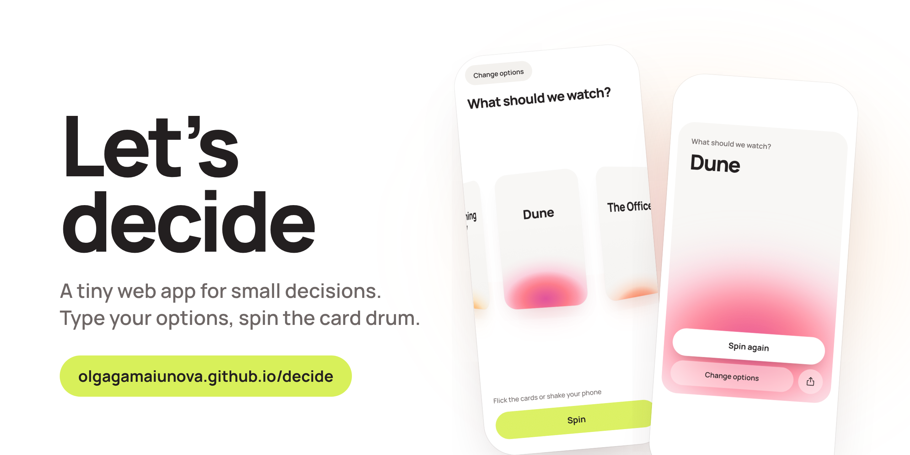
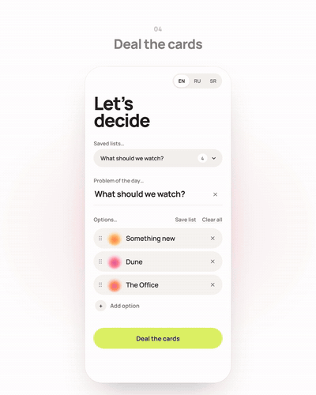
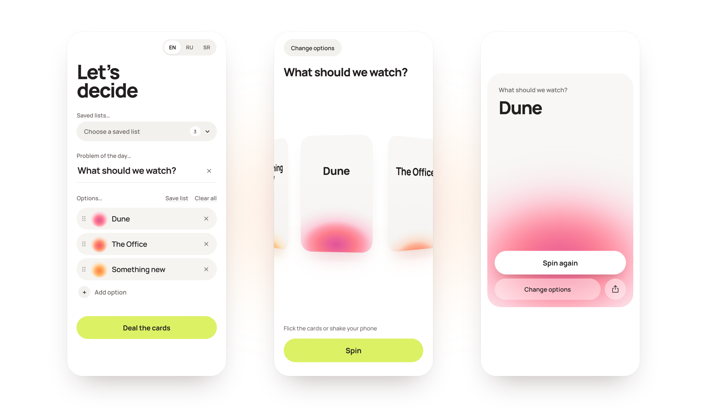
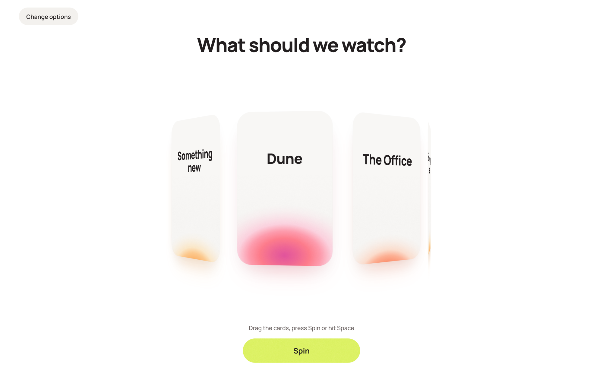
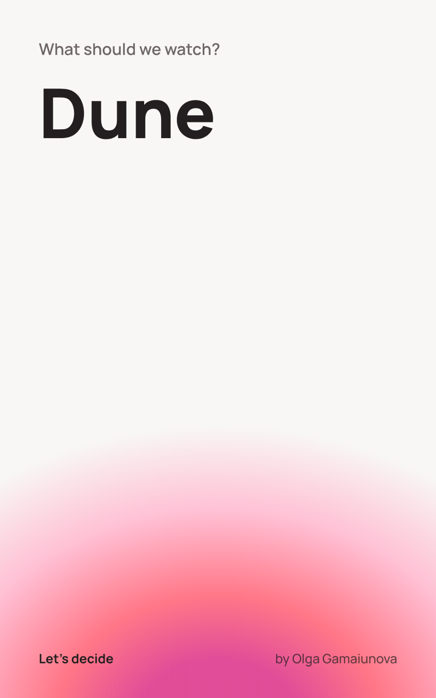

  

<h1 align="center">Let’s decide</h1>

  A tiny web app for small decisions. Type your options, deal the cards, spin the drum. 
  <a href="https://olgagamaiunova.github.io/decide/"><b>Try it live →</b></a>

  <a href="#english">English</a> · <a href="#русский">Русский</a>

---

## English

### Why

My husband and I can never quickly agree on what to eat or what to watch. A coin only works for two options, and a random number generator is no fun. So I designed a small ritual for it: write your options, deal them as cards, spin the drum and let it decide.

  

### Features

- **Any question, any options.** From 2 up to 20 options, each gets its own aura colour.
- **3D card drum.** Flick it, drag it, press Spin or hit Space on desktop.
- **Shake to spin.** On a phone, just shake it (iPhone asks for motion access once).
- **Fair by design.** The winner is picked at random the moment you spin; the animation only eases into it. A weak flick still makes a couple of full turns, so you can’t aim.
- **Share as an image.** The result becomes a card picture you can send to a chat, so nobody can say “I never agreed to that”.
- **Saved lists.** Your last list is remembered automatically. Recurring questions like “What’s for dinner?” can be saved and reopened in one tap.
- **Drag to reorder** options, or use the arrow keys on the handle.
- **One-tap clearing** for the question, a single option or everything at once.
- **Three languages:** English, Russian and Serbian, picked from your device and remembered.
- **Respects “Reduce motion”** and works without sound.

  

### Design notes

- **Metaphor.** I started with a slot machine, then tried a wheel and an arc of cards, and landed on a 3D drum: it reads as a roulette without any explanation and works the same on a phone and on a desktop.
- **Cards.** Light, slightly grainy paper with a soft aura rising from the bottom. The colour family is warm (rose, coral, apricot, orchid, lavender) so any set of options looks harmonious.
- **Type.** Manrope ExtraBold for the cards and headings, the same family for the interface.
- **Result.** The winning card grows into the result card itself instead of opening a separate panel, so there is no duplicated content.
- **Mobile Safari.** Most of the polishing went into iPhone quirks: 3D layers that ignored rounded corners, blurred layers that striped in perspective, cards intersecting in 3D, the keyboard resizing the viewport mid-animation, and the system “Undo Typing” sheet on shake.

  

  

### Tech

A single `index.html`: vanilla JavaScript, CSS 3D transforms and [GSAP](https://gsap.com) for the motion. No build step, no backend, no tracking. Saved lists live in your browser’s local storage and never leave your device.

To run it locally, just open `index.html` in a browser. Shake to spin needs HTTPS, which GitHub Pages provides.

### Author

Designed and built by **Olga Gamaiunova**, product and UX/UI designer.

---

## Русский

### Зачем

Мы с мужем постоянно не можем быстро решить, что поесть или что посмотреть вечером. Монетка подходит только для двух вариантов, а генератор случайных чисел скучный. Поэтому я сделала маленький ритуал: пишешь варианты, раздаёшь их картами, крутишь барабан, и он решает за вас.

### Что умеет

- **Любой вопрос и любые варианты:** от 2 до 20, у каждого свой цвет ауры.
- **3D-барабан из карт:** смахни, потяни, нажми «Крутить» или пробел на компьютере.
- **Потряси, чтобы раскрутить:** на телефоне достаточно встряхнуть его (iPhone один раз попросит доступ к датчикам).
- **Честный выбор:** победитель выбирается случайно в момент запуска, анимация только плавно к нему подводит. Даже слабый свайп даёт пару оборотов, прицелиться нельзя.
- **Поделиться картинкой:** результат превращается в карточку, которую можно отправить в чат.
- **Сохранённые списки:** последний список запоминается сам, а частые вопросы вроде «Что на ужин?» можно сохранить и открывать в один тап.
- **Перетаскивание вариантов** за ручку или стрелками с клавиатуры.
- **Очистка в одно касание:** вопрос, один вариант или всё сразу.
- **Три языка:** русский, английский и сербский.
- **Учитывает настройку «Уменьшить движение»**, работает без звука.

### Технологии

Один файл `index.html`: чистый JavaScript, CSS 3D и [GSAP](https://gsap.com) для анимаций. Без сборки, без сервера, без аналитики. Сохранённые списки хранятся только в браузере на твоём устройстве.

### Автор

Дизайн и разработка: **Ольга Гамаюнова**, продуктовый и UX/UI-дизайнер.
